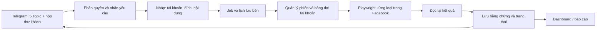

# Kế hoạch hoàn thiện KudoX: vận hành Facebook từ Telegram

Ngày đối chiếu: **20/10/2026**. Dự án triển khai: **`D:\KudoX_Mess_Tele`**.

**Trạng thái tài liệu:** kế hoạch dựa trên code và tài liệu đang có; chưa phải danh sách chức năng đã nghiệm thu. Lượt lập kế hoạch này không phát sinh bài đăng, bình luận, lời mời hoặc cảm xúc trên Facebook.

## 1. Kết quả cần đạt

Người vận hành dùng nhóm Telegram **Messenger Eco Trang**, giữ đúng năm Topic trong ảnh:

1. **Đăng bài Facebook:** soạn, chọn tài khoản và nơi đăng, xem trước, đăng ngay/hẹn giờ, sửa nháp, hủy lịch, nhận kết quả từng đích.
2. **Bình luận bài viết:** gửi link và nội dung, xem bình luận, trả lời đúng bình luận, quản lý mẫu, theo dõi tương tác và cấu hình tự động khi chủ động bật.
3. **Quét mem mới trong group:** chọn nhóm, tạo mốc, quét thay đổi, đọc kết quả có nguồn và phạm vi rõ ràng.
4. **Kết bạn:** chọn đúng hồ sơ, xem trạng thái, gửi lời mời và kiểm tra kết quả.
5. **Tương tác Story/bài viết:** chọn đúng nội dung, chọn cảm xúc có hỗ trợ, kiểm tra trạng thái sau thao tác.

Các Topic khách hàng tiếp tục làm hộp thư Messenger hai chiều. Menu dùng chung cung cấp tài khoản, tình trạng kết nối, hàng đợi, lịch, báo cáo, quyền nhân viên và nút tạm dừng.

**Chuẩn hoàn thành:** một thao tác từ Telegram phải chạy đúng tài khoản, đúng đối tượng, đúng nội dung; có kết quả đối chiếu được; không lặp do bấm hai lần hoặc khởi động lại. Dashboard đọc cùng dữ liệu và cùng kết quả thực thi.

Phạm vi bắt buộc là năm nhóm chức năng trên, Messenger và quản trị đã có trong kế hoạch dự án. Từng loại nội dung sẽ được công bố theo mức hỗ trợ thực tế. Page, Reel, đăng Story, sửa/xóa bài đã đăng, chấp nhận/hủy lời mời là các mục mở rộng có luồng nghiệm thu riêng; không mặc nhiên coi chúng đã có.

Vận hành thường ngày có thể thực hiện trong Telegram khi phiên Facebook hợp lệ. Đăng nhập lần đầu, hết phiên hoặc yêu cầu xác minh của Facebook có thể cần chủ tài khoản xử lý trong trình duyệt. Máy chạy KudoX cần tiếp tục hoạt động và có mạng. Lưu profile giúp tái sử dụng phiên, không bảo đảm đăng nhập vĩnh viễn.

## 2. Nguồn đã đối chiếu và hiện trạng

### 2.1. Nguồn nội bộ

- [KUDOX_HANDOFF.md](D:/KudoX_Mess_Tele/KUDOX_HANDOFF.md): luồng năm Topic, quyền Sale/Admin, yêu cầu xác nhận, các mục Messenger còn phải nghiệm thu.
- [README.md](D:/KudoX_Mess_Tele/README.md): kiến trúc chạy hiện tại.
- [Kế hoạch ban đầu](<D:/MESS x TELE/ke_hoach_trien_khai_mess_x_tele.md>): đồng bộ hai chiều, SQLite, tự phục hồi, `/chat`, `/close`, `/info`, đa phương tiện.
- [manual_template.html](D:/KudoX_Mess_Tele/manual_template.html): menu Telegram, nhiều tài khoản/proxy, lịch, mẫu trả lời, báo cáo 22h. Tài liệu còn mô tả hai Topic cũ và một số khả năng chưa được code bảo đảm; dùng để thu thập yêu cầu, không làm bằng chứng chức năng đã xong.
- Code chính: `src/telegram/bot.ts`, các engine, composer, browser session, checkpoint guard, hai JSON store, API dashboard và frontend.
- Ảnh người dùng cung cấp: năm Topic là bố cục giao diện mục tiêu.

Đã có TypeScript, grammY, Express, Playwright và Chrome persistent profile. Manifest khai báo Playwright `^1.50.1`; bản trong `node_modules` lúc đọc là **1.64.1**. Việc triển khai cần khóa phiên bản đã kiểm chứng, không nâng thư viện hàng loạt trong cùng đợt sửa nghiệp vụ.

Chưa kiểm chứng các nhãn/selector trên đủ màn hình Facebook sống trong lượt lập kế hoạch này. Bộ công cụ trình duyệt hiện chỉ liệt kê các tab dashboard; vì vậy danh mục DOM ở mục 4 là việc phải thu thập khi triển khai, không phải kết quả F12 đã xác nhận hôm nay.

### 2.2. Khoảng trống đã xác nhận trong code

| Mã | Hiện trạng | Việc phải làm | Điểm bắt đầu |
|---|---|---|---|
| F01 | API chạy bài tự chuyển thành completed sau 4 giây | Gọi executor thật; lưu kết quả từng đích | [dashboard.ts:640](D:/KudoX_Mess_Tele/src/ui/dashboard.ts:640) |
| F02 | Bình luận có thể trả true dù chưa gửi; caller bỏ qua `submitted` | Định vị đúng bài, hậu kiểm comment thật | [facebook-composer.ts:78](D:/KudoX_Mess_Tele/src/core/facebook-composer.ts:78), [auto-comment-engine.ts:306](D:/KudoX_Mess_Tele/src/engine/auto-comment-engine.ts:306) |
| F03 | Đổi nick trong Telegram chỉ thay default trong DB | AccountService chuyển phiên và xác minh tài khoản thật | [bot.ts:916](D:/KudoX_Mess_Tele/src/telegram/bot.ts:916) |
| F04 | Một số trạng thái online và ping 42ms được gán sẵn | Trạng thái đo được, có thời điểm đo và lý do lỗi | [bot.ts:1616](D:/KudoX_Mess_Tele/src/telegram/bot.ts:1616), [dashboard.ts:651](D:/KudoX_Mess_Tele/src/ui/dashboard.ts:651) |
| F05 | Bấm Đăng rồi chờ được tính thành công; một đích thành công có thể che các đích lỗi | Receipt riêng cho từng tài khoản/đích; pending duyệt tách khỏi published | [messenger-engine.ts:1203](D:/KudoX_Mess_Tele/src/engine/messenger-engine.ts:1203), [messenger-engine.ts:1279](D:/KudoX_Mess_Tele/src/engine/messenger-engine.ts:1279) |
| F06 | Nháp thiếu người sở hữu; “ok” lấy nháp mới nhất trong Topic; chọn nhóm thực tế là tất cả nhóm active | Nháp theo người tạo/chat/Topic; chọn từng đích và khóa tài khoản | [auto-comment-store.ts:418](D:/KudoX_Mess_Tele/src/db/auto-comment-store.ts:418), [bot.ts:1359](D:/KudoX_Mess_Tele/src/telegram/bot.ts:1359) |
| F07 | Callback cũ có thể gọi đăng lại; hàng đợi chủ yếu ở RAM | Job bền vững, claim nguyên tử, khóa chạy, xử lý callback hết hạn | [bot.ts:826](D:/KudoX_Mess_Tele/src/telegram/bot.ts:826), [bot.ts:1463](D:/KudoX_Mess_Tele/src/telegram/bot.ts:1463) |
| F08 | Quét member đọc link toàn trang, lấy tối đa 50, dùng thứ tự recent activity | Scope đúng danh sách thành viên; báo “mới thấy” khi chưa có bằng chứng gia nhập | [facebook-actions-engine.ts:73](D:/KudoX_Mess_Tele/src/engine/facebook-actions-engine.ts:73) |
| F09 | Reaction dùng nút toàn trang và báo xong sau click; pending action thiếu account | Adapter post/story riêng, khóa đúng target/account, kiểm tra trạng thái | [facebook-actions-engine.ts:172](D:/KudoX_Mess_Tele/src/engine/facebook-actions-engine.ts:172), [bot.ts:53](D:/KudoX_Mess_Tele/src/telegram/bot.ts:53) |
| F10 | Mapping thiếu account/chat scope; media E2EE được gom theo khoảng thời gian | Ánh xạ đầy đủ; media phải gắn đúng hội thoại/sự kiện | [store.ts:5](D:/KudoX_Mess_Tele/src/db/store.ts:5), [messenger-engine.ts:659](D:/KudoX_Mess_Tele/src/engine/messenger-engine.ts:659) |
| F11 | Auto-comment mở thêm context cùng profile, quota/mode chưa được thực thi đầy đủ | SessionManager chung, dừng thật, hạn mức và chế độ có hiệu lực | [auto-comment-engine.ts:164](D:/KudoX_Mess_Tele/src/engine/auto-comment-engine.ts:164), [browser-session.ts:77](D:/KudoX_Mess_Tele/src/core/browser-session.ts:77) |
| F12 | Thiếu ảnh tải lên vẫn có thể tiếp tục đăng | Media có manifest; đủ file và preview trước submit | [bot.ts:1499](D:/KudoX_Mess_Tele/src/telegram/bot.ts:1499), [messenger-engine.ts:1186](D:/KudoX_Mess_Tele/src/engine/messenger-engine.ts:1186) |

Nền có thể kế thừa: năm Topic, role Sale/Admin, mẫu nội dung, bước xem trước, lịch hiện tại, profile từng tài khoản, `withNewFacebookPage` mở tab riêng trong hàng đợi. Cần sửa/tách dần các phần này thành dịch vụ chung.

## 3. Thiết kế thực thi chung



### 3.1. Công nghệ và cách tách code

- Giữ Node.js + TypeScript + grammY + Playwright + Express đang dùng.
- Dùng **SQLite có transaction và unique constraint** cho jobs, mapping, sự kiện, lịch và receipts. Chọn driver phù hợp Node/Windows trong bước triển khai nền; có migration từ hai JSON store, backup và phương án khôi phục.
- Tách handler Telegram theo Topic. `bot.ts` chủ yếu đăng ký route; nghiệp vụ chuyển vào service để API và Telegram gọi giống nhau.
- Tách browser adapter: post, comment, member list, profile friendship, post reaction, story reaction, Messenger.
- SessionManager sở hữu duy nhất một persistent context cho mỗi profile. Dùng tab riêng cho tác vụ Facebook; giữ tab Messenger. Không mở hai context cùng profile, không xóa lock của Chrome còn chạy.
- Hàng đợi theo tài khoản và khóa theo page/surface: thao tác gõ, paste, upload, đổi trang không đè nhau. Xác định giới hạn tài nguyên trước khi chạy nhiều tài khoản đồng thời.
- Khởi đầu ổn định với tài khoản hiện tại, sau đó nghiệm thu tài khoản thứ hai. Mọi job đã xác nhận giữ nguyên account; đổi nick mặc định chỉ ảnh hưởng yêu cầu mới.
- Dùng API chính thức khi có hỗ trợ phù hợp loại tài khoản và quyền đã cấp. Các luồng hiện tại dùng browser adapter; không mặc định API cho Page cũng dùng được cho tài khoản cá nhân hoặc group.

### 3.2. Định danh và dữ liệu

| Dữ liệu | Trường/khóa thiết yếu |
|---|---|
| Tài khoản | accountId, profileDir, UID đã xác minh, generation của phiên, trạng thái, lastVerifiedAt |
| Mapping hội thoại | unique `(accountId, fbThreadId)` và `(telegramChatId, telegramTopicId)`; lịch sử mapping cũ |
| Nháp | draftId, creatorTelegramId, chatId, topicId, sourceMessageId, accountId, target list, payloadVersion |
| Job | jobId, action, requesterId, sourceUpdateId, accountId, payloadHash/version, confirmationId, scheduledAt, timezone, trạng thái |
| Đích thực thi | jobId + targetId, canonical URL, attempt, lease, startedAt, outcome, result URL/ID, error code |
| Sự kiện tin nhắn | accountId, threadId, message/event ID, direction, timestamp, source, delivery state |
| Media | mediaId, nguồn, MIME, kích thước, checksum, thứ tự, caption, account/thread/event liên quan, vòng đời file |
| Bằng chứng | jobId, account, target, URL/ID kết quả, observedAt, trạng thái UI, đường dẫn ảnh/trace khi cần |
| Theo dõi nhóm | groupId, account/access scope, baseline, scanRunId, firstSeenAt/lastSeenAt, completeness |
| Bình luận | postId, commentId, parentCommentId, author/account, Telegram message tương ứng, trạng thái theo dõi |

Mapping cũ thiếu nguồn phải vào danh sách cần đối chiếu, không tự gán toàn bộ cho nick mặc định. Nháp/lịch cũ thiếu người tạo hoặc tài khoản phải tạm ngừng thực thi, gán lại đúng chủ/tài khoản và xác nhận lại trong Telegram trước khi tiếp tục. Migration bảo toàn Topic ID, drafts, lịch và account. Giữ bản dữ liệu trước migration để khôi phục.

### 3.3. Vòng đời công việc

`nháp → chờ xác nhận → đã lên lịch/đang chờ → đang chạy → đang xác minh → kết quả`.

Kết quả phân biệt:

- **Thành công đã xác minh**: đúng tài khoản, đối tượng, nội dung và bằng chứng.
- **Thành công một phần**: ví dụ hai nhóm đã đăng, một nhóm lỗi.
- **Chờ quản trị viên nhóm duyệt**: Facebook đã nhận bài nhưng chưa xuất bản.
- **Chưa xác minh**: có khả năng thao tác đã xảy ra nhưng chưa đọc được kết quả.
- **Cần đăng nhập/xử lý phiên**, **bị giới hạn**, **lỗi**, **đã hủy**, **bỏ lỡ lịch**.

Mỗi yêu cầu Telegram có khóa chống nhận trùng. Mỗi lần xác nhận gắn với người tạo, tài khoản, đích và phiên bản nội dung. Sửa bất kỳ phần nào thì thẻ xác nhận cũ hết hiệu lực.

Với thao tác công khai thủ công: hiện một thẻ xem trước đầy đủ và nút xác nhận cho từng việc. Với chế độ tự động được chủ động bật: thẻ xác nhận áp dụng cho cấu hình có phạm vi và phiên bản; mỗi job lưu policyId/version và confirmationId, kiểm tra lại quyền, phạm vi, hạn mức và trạng thái bật ngay trước submit. Thay đổi phạm vi/nội dung của cấu hình cần được duyệt lại. Với tin Messenger, hành động gửi tin trong Topic khách là yêu cầu gửi, không thêm một hộp xác nhận cho từng câu chat.

Khi timeout sau submit, không tự gửi lại. Trước hết tra kết quả bằng ID/receipt hoặc đọc lại đúng đích; nếu vẫn mơ hồ thì giữ trạng thái “chưa xác minh” và cho người dùng quyết định trong Telegram. Facebook UI không cung cấp cơ chế exactly-once chung; khóa nội bộ không thể thay thế bước đối chiếu này.

Job chưa submit có thể hủy. Khi Facebook đã nhận thao tác, “hủy job” không được quảng bá là đã thu hồi bài/comment/lời mời; thu hồi là một hành động riêng.

### 3.4. Menu Telegram chung

Giữ năm Topic và một tin hướng dẫn ghim có các nút đúng chức năng. Dùng một tin trạng thái được cập nhật theo tiến độ, có phân trang khi danh sách dài.

| Nhóm menu | Tác vụ |
|---|---|
| `/menu` | Mở năm chức năng, trạng thái, lịch, công việc của tôi |
| `/nicks` | Xem/chọn nick thật, tình trạng phiên, kiểm tra proxy có số đo thật |
| `/status` | Bot, browser, Messenger, account, PIN/login/checkpoint, thời điểm kiểm tra |
| Lịch / hàng đợi | Hôm nay, sắp tới, đã xong, lỗi, chưa xác minh; xem/sửa/hủy |
| Tạm dừng / tiếp tục | Theo tính năng hoặc tài khoản; chặn submit kế tiếp |
| Nhóm / mẫu / từ khóa | Thêm, sửa, bật/tắt; hiện phạm vi sử dụng |
| Nhân viên | Admin cấp/thu hồi quyền, gán tài khoản và phạm vi hành động |
| Báo cáo | Kết quả thật theo ngày/tài khoản/người thao tác; giờ Việt Nam |

Callback lưu ID ngắn ở nút và dữ liệu ở server, kiểm tra quyền lại khi nhấn; không tin dữ liệu từ nút cũ. Telegram giới hạn `callback_data` và yêu cầu trả `answerCallbackQuery` để kết thúc trạng thái chờ của nút. Dùng `chat_id` và `message_thread_id` để trả đúng Topic, xử lý `retry_after` khi bị giới hạn. [Telegram Bot API](https://core.telegram.org/bots/api#inlinekeyboardbutton)

## 4. Quy trình dùng F12 và Playwright

### 4.1. Thu thập mẫu thật trước khi viết selector

Với mỗi loại trang, mở một đối tượng mẫu mà tài khoản có quyền xem. Ghi nhận:

1. URL đầu vào, URL sau redirect, permalink, ID bài/group/profile/comment/story nếu có.
2. Vùng chứa đối tượng: article, dialog, profile header, member list, story viewer, Messenger thread.
3. `role`, accessible name, `aria-label`, `placeholder`, `contenteditable`, `href`, quan hệ với vùng cha.
4. Điều kiện trước thao tác: đúng tài khoản, đúng đối tượng, quyền bình luận/đăng, nút khả dụng.
5. Trạng thái sau thao tác: nội dung thật đã xuất hiện, ID/link kết quả, đang chờ duyệt hoặc thông báo lỗi.
6. Ngôn ngữ vi/en, loại giao diện, ngày kiểm tra, phiên bản adapter; ảnh và DOM mẫu đã loại dữ liệu riêng.

F12 Elements/Accessibility phục vụ kiểm tra nhãn và cấu trúc; Network phục vụ xem request/response phát sinh từ thao tác được thực hiện trong phiên. Không đưa cookie, Authorization hoặc toàn bộ HAR chứa thông tin phiên vào tài liệu chia sẻ. [Chrome Accessibility](https://developer.chrome.com/docs/devtools/accessibility/reference), [Chrome Network](https://developer.chrome.com/docs/devtools/network)

### 4.2. Quy tắc định vị

- Chuẩn hóa hostname và link share qua đích điều hướng thực tế; giữ query chứa ID như `story_fbid`, `id`, `comment_id`. Chỉ chấp nhận đích Facebook phù hợp loại tác vụ.
- Tìm **đúng vùng của đối tượng trước**, sau đó mới tìm editor/nút trong vùng đó.
- Ưu tiên `getByRole`, `getByLabel` và accessible name; có từ điển nhãn vi/en. CSS ổn định chỉ làm dự phòng đã kiểm chứng.
- Yêu cầu locator xác định duy nhất một mục hợp lệ. Không dùng `.first()`/`.last()` toàn trang để che lỗi nhiều kết quả.
- Đợi điều kiện như editor khả dụng, upload đủ file, trạng thái kết quả xuất hiện. Auto-wait trước click không tự xác nhận nghiệp vụ đã thành công.
- Khi không đủ bằng chứng: dừng tác vụ, ghi stage/URL/ảnh chẩn đoán; không chuyển sang ô bình luận của bài khác.

Đây là cách áp dụng locator theo thuộc tính người dùng nhìn thấy và scope trong container; Playwright hỗ trợ tự chờ điều kiện thao tác nhưng ứng dụng vẫn phải tự kiểm tra hậu điều kiện. [Playwright Locators](https://playwright.dev/docs/locators), [Auto-waiting](https://playwright.dev/docs/actionability)

### 4.3. Danh mục adapter cần hoàn tất

| Màn hình | Đối tượng cần định vị | Bằng chứng kết quả |
|---|---|---|
| Composer profile/group | Đúng tài khoản/đích, editor, file input, preview, nút đăng | Bài mới/permalink hoặc trạng thái pending duyệt |
| Bài viết/permalink/dialog | Post root, nút mở bình luận, editor, nút gửi | Comment đúng tác giả/nội dung và comment ID/link nếu có |
| Trả lời bình luận | Comment root cụ thể và reply editor của nó | Reply thuộc đúng parent comment |
| Group members | Danh sách và từng hàng thành viên | Snapshot có phạm vi/nguồn, UID hoặc alias được ghi rõ |
| Profile cá nhân | Header và vùng hành động của profile đích | Đã là bạn/đang chờ/không thể gửi |
| Post reactions | Article đúng permalink và control phản ứng | Cảm xúc hiện tại của tài khoản trên bài đó |
| Story | Viewer, chủ Story, item hiện tại và controls | Đúng item, phản hồi từ UI/request liên quan nếu có |
| Messenger | Thread, từng message, composer và media tương ứng | Nội dung xuất hiện ở đúng thread, trạng thái giao được lưu |

Lưu trace cục bộ khi chẩn đoán lỗi và chỉ chia sẻ bản đã kiểm tra dữ liệu. Trace Viewer cho phép xem DOM và thao tác trước/sau để biết selector đã tác động vào đâu. [Playwright Trace Viewer](https://playwright.dev/docs/trace-viewer)

Không dùng response HTTP 200, editor trống, modal đóng hoặc thời gian chờ cố định làm bằng chứng duy nhất. Network của Facebook có thể thay đổi; chỉ coi dữ liệu quan sát được là tín hiệu bổ sung, không giả định endpoint nội bộ là API ổn định.

## 5. Thứ tự triển khai và điểm chốt từng đợt

| Đợt | Nội dung | Điều kiện chuyển đợt |
|---|---|---|
| P0 | Kết quả thật, session/account, dữ liệu, job, quyền, bộ định vị dùng chung; xử lý rủi ro trộn hội thoại | Job chạy đúng nick/đích, restart không chạy lặp mù quáng, không còn đường completed bằng timer |
| P1 | Topic 1: đăng một đích → media → nhiều đích → hẹn giờ | Có kết quả từng đích, đầy đủ media, lịch giữ nguyên payload và account |
| P2 | Topic 2: comment → reply → theo dõi → mẫu/tự động | Đúng bài/comment, giữ nguyên nội dung, không báo thành công khi chưa xác minh |
| P3 | Topic 3: baseline → quét thay đổi → lịch theo dõi → phân trang | Không nhầm mới thấy với mới gia nhập; dữ liệu không bị mất khi quét lỗi |
| P4 | Topic 4: một lời mời → theo dõi trạng thái → mở rộng quản lý lời mời | Đúng profile/nick; không gửi lại lời mời đang chờ |
| P5 | Topic 5: post Like/Love → Story → các cảm xúc được hỗ trợ | Đúng bài/item; bấm lặp không làm mất hoặc đổi sai cảm xúc |
| P6 | Hoàn thiện Messenger đa phương tiện, menu quản trị, nhiều tài khoản, phục hồi và báo cáo | Ma trận dữ liệu/đồng thời/restart đạt; nghiệm thu toàn luồng bằng Telegram |

Sửa nền composer có thể làm trong P0 để các tính năng dùng chung. Việc bàn giao cho người dùng vẫn đi lần lượt Topic 1 → 2 → 3 → 4 → 5. Trong P0 phải xử lý nguy cơ media sai khách trước khi bật thêm công việc song song; P6 mở rộng nghiệm thu toàn bộ Messenger.

## 6. Topic 1 — Đăng bài Facebook

### Trải nghiệm Telegram

1. Gửi nội dung, ảnh/album hoặc video vào Topic 1. Bot tạo thẻ nháp thuộc người soạn, hiển thị số file, caption và tài khoản.
2. Bấm **Chọn nick** và **Chọn nơi đăng**. Chọn từng group đã thêm hoặc trang cá nhân; có tìm kiếm, phân trang và nút bỏ chọn.
3. Bấm **Xem trước** để xem đúng văn bản, thứ tự media và toàn bộ đích. Có **Sửa nội dung**, **Thêm/bỏ media**, **Đổi đích**.
4. Chọn **Đăng ngay** hoặc **Hẹn giờ**; hẹn giờ nhập ngày và giờ Việt Nam, xem lại thời điểm cụ thể.
5. Bấm xác nhận trên thẻ đó. Bot cập nhật tiến độ cùng thẻ và trả kết quả riêng từng đích.
6. Mở **Bài của tôi / Lịch** để đổi lịch, hủy tác vụ chưa chạy hoặc xem lại link bài.

Ví dụ thẻ kết quả đề xuất:

```text
Bài #P104 · Tài khoản: Eco Trang
Nội dung: [nội dung đã duyệt] · Media: 3/3 ảnh

Trang cá nhân: Đã xác minh — [Mở bài]
Nhóm A: Chờ quản trị viên nhóm duyệt
Nhóm B: Chưa đăng — không có quyền

[Chi tiết] [Xử lý đích lỗi] [Lịch của tôi]
```

### Công việc kỹ thuật

- Tách `PostService` khỏi bot và Messenger engine; cả dashboard lẫn Telegram gọi service này.
- Gom album theo chat + topic + người gửi + media_group_id; lưu từng phần trước khi ghép. Không mặc định sau 1,2 giây là đã nhận đủ ảnh.
- Lưu file bền cho bài hẹn giờ, manifest gồm số lượng/MIME/checksum/caption. Lỗi tải/upload một file phải dừng trước submit hoặc yêu cầu người soạn cập nhật bản nháp.
- Kiểm tra hạn mức tải file Telegram trước khi xếp việc. Bot API đám mây hiện giới hạn tải qua `getFile` ở 20 MB; file vượt khả năng cần thông báo rõ hoặc triển khai Local Bot API thành một hạng mục riêng. [Telegram File](https://core.telegram.org/bots/api#file)
- Mỗi `(accountId, targetId)` là một bản thực thi con. Chụp danh sách đích lúc xác nhận; nhóm mới thêm không tự tham gia bài cũ.
- Trước submit kiểm tra tài khoản thực tế, nơi đăng, nội dung đã điền, số preview media và quyền đăng.
- Sau submit lưu ID/link bài hoặc bằng chứng pending duyệt. Không coi một đích thành công là toàn bộ bài thành công.
- Đích bị gỡ hoặc mất quyền trước giờ chạy phải được đánh dấu rõ, không âm thầm đổi sang nơi khác.
- Scheduler dùng cùng hàng đợi với lệnh đăng ngay, lưu ngày giờ đầy đủ và timezone. Lịch quá hạn hiện tại là hai phút; đưa quy tắc này thành cấu hình rõ trên Telegram. Khi máy hoạt động lại sau hạn: báo bỏ lỡ, cho chọn lịch mới/đăng ngay.
- Lịch đang chạy và callback cũ dùng chung khóa job. Kết quả chưa xác minh phải được đối chiếu trước retry.

### Nghiệm thu P1

- Một bài văn bản; một ảnh có caption; album đủ thứ tự; video được upload và xác minh riêng.
- Hai người soạn đồng thời không duyệt nhầm bài; đổi nick mặc định không đổi account của lịch đã xác nhận.
- Một bài ba đích có đủ ba kết quả, bao gồm chờ duyệt và lỗi quyền.
- Bấm nút hai lần, Telegram gửi lại update hoặc restart không tạo bài thứ hai ngoài ý muốn.
- Upload lỗi không sinh bài thiếu ảnh; mất mạng sau submit đi vào “chưa xác minh”.
- Lịch qua ngày, sửa lịch, hủy lịch, ngủ máy quá giờ đều có hành vi được báo rõ.

**Mở rộng sau P1:** sửa/xóa bài do chính tài khoản sở hữu, đăng Page/Reel/Story. Mỗi loại phải có adapter, xác định quyền và nghiệm thu riêng trước khi đưa nút vào menu khả dụng.

## 7. Topic 2 — Bình luận, trả lời và theo dõi bài viết

### Trải nghiệm Telegram

1. Gửi link bài → bot đọc đích và trả thẻ tên tác giả/nhóm, trích đoạn, link chuẩn và tài khoản thực hiện.
2. Gõ nội dung hoặc chọn mẫu đã lưu; thêm ảnh nếu loại composer đã được kiểm chứng hỗ trợ.
3. Xem trước → **Gửi bình luận** → nhận link comment hoặc bằng chứng đã xuất hiện đúng bài.
4. **Xem bình luận** hiển thị danh sách phân trang; chọn đúng comment → **Trả lời** → xem trước → gửi.
5. **Theo dõi bài này** đưa comment mới của bài đã đăng ký về Topic 2. Reply đúng thẻ Telegram sẽ tạo reply cho đúng Facebook comment.
6. Với comment của chính tài khoản: menu **Sửa/Xóa** có preview đối tượng và hậu kiểm riêng.

Giữ nguyên câu chữ người dùng nhập. Mẫu BĐS, câu trả lời nhanh và thư viện comment được quản lý trong Telegram. Nếu sau này thêm AI hỗ trợ soạn, đầu ra chỉ là bản nháp để người dùng duyệt; không tự thay nội dung đã duyệt và không đưa lại lời hứa “spin-text bảo đảm an toàn”.

### Công việc kỹ thuật

- Tách `CommentService`, chuẩn hóa post/comment/parent ID và account.
- Dùng `targetPostId` thực sự để scope composer. Bỏ nhánh tìm không thấy comment rồi reply vào mục đầu tiên.
- Phân biệt editor comment gốc và reply; xác định đúng parent ngay trước submit.
- `submitComment` trả kết quả cấu trúc, gồm confirmed/failed/uncertain. Caller phải xử lý kết quả và lỗi, không ghi success mặc định.
- Hậu kiểm tác giả, nội dung, media và vị trí comment trong đúng bài. Có ID thì lưu ID; nếu không có permalink và chứng cứ chưa đủ thì giữ “chưa xác minh”.
- Với link có `comment_id`, giữ ID qua chuẩn hóa. Link share phải resolve trước khi lập thẻ xác nhận.
- Dữ liệu theo dõi có checkpoint theo từng post, chống trùng theo comment ID; không quét vô hạn toàn Facebook.
- Lưu mapping Telegram message ↔ Facebook post/comment. Comment xuất hiện từ hệ thống vẫn được ghi nhận trạng thái nhưng không tạo vòng phản hồi lặp.
- Bình luận bị khóa/ẩn/lọc/chờ duyệt phải có trạng thái tương ứng nếu giao diện cung cấp. Không tìm thấy ngay không đồng nghĩa đã xóa hoặc chưa từng gửi.

### Theo dõi và bình luận tự động

Thực hiện sau khi bình luận thủ công đạt nghiệm thu:

- Menu quản trị nhóm theo dõi, từ khóa, mẫu, tài khoản và khung giờ.
- Mặc định đề xuất bài phù hợp → người dùng duyệt trong Telegram.
- Chế độ tự động chỉ chạy trong phạm vi cấu hình đã được quản trị viên xem và bật: nhóm, mẫu nguyên văn, tài khoản, hạn mức, thời gian và điều kiện dừng.
- `mode` và hạn mức theo tài khoản/ngày phải có tác dụng thật. Quota được giữ chỗ bằng transaction trước submit; các lần chưa rõ kết quả không được bỏ qua để tiếp tục gửi không giới hạn.
- Tắt/dừng kiểm tra lại trước từng submit, kể cả vòng đang chờ delay. Công việc đã gửi được báo riêng.
- Mỗi bài phải có định danh/link thực; không lấy URL group làm URL bài, không tạo post ID từ thời gian để vượt bước thiếu dữ liệu.
- SessionManager dùng chung phiên với các tác vụ khác, không mở trùng persistent profile.

### Nghiệm thu P2

- Trang có nhiều bài/ô nhập vẫn comment đúng bài; reply đúng comment dù nhiều người trùng tên.
- Enter không gửi hoặc nút gửi bị lỗi không được báo thành công.
- Nội dung có dấu tiếng Việt, nhiều dòng, emoji/link và ảnh được giữ đúng.
- Mất mạng sau gửi không tự bình luận thêm lần nữa.
- Comment mới trên bài đã đăng ký theo dõi xuất hiện đúng thẻ Telegram; trả lời thẻ đi đúng comment.
- Hai nhân viên/nick không lẫn draft; sửa/xóa chỉ áp dụng đối tượng sở hữu đã chọn.
- Auto-comment tắt thật, dừng đúng trước lần submit kế tiếp, không vượt hạn mức, không lặp bài do thay thứ tự feed.

## 8. Topic 3 — Quét thành viên nhóm

### Trải nghiệm Telegram

`Link group → thẻ nhóm/tài khoản/quyền xem → [Tạo mốc] hoặc [Quét ngay] → kết quả phân trang`.

Nút bổ sung: **Theo dõi định kỳ**, **Lịch sử**, **Tạm dừng**, **Đặt lại mốc có xác nhận**, **Mở hồ sơ**, **Chuyển sang Topic Kết bạn**.

Kết quả ghi thời điểm và phạm vi quan sát:

```text
Nhóm A · Lần quét #G28
Đã quan sát: 150 hồ sơ · Phạm vi: một phần danh sách
Mới thấy so với các lần trước: 8
Có thông tin thời điểm tham gia từ Facebook: 2
Chưa xác định thời điểm tham gia: 6

[Xem kết quả] [Quét tiếp] [Lịch sử]
```

### Công việc kỹ thuật

- Chuẩn hóa root group trước khi mở members, kể cả đầu vào đã có `/members/` hoặc là link bài trong group.
- Đọc đúng member list và từng hàng; loại link sidebar, gợi ý và phần ngoài danh sách. Không dùng toàn bộ `a[href]`.
- Dùng UID khi giao diện cung cấp; alias được lưu riêng. Không gộp hai người chỉ vì trùng tên.
- Snapshot gắn group và phạm vi truy cập của tài khoản. Đổi nick hoặc mất quyền không tạo hàng loạt “thành viên mới”.
- Cuộn có ngân sách, đếm số quan sát, lý do dừng và completeness. Dừng khi hết danh sách/không có dữ liệu mới/hết giới hạn/bị chặn.
- Lần đầu lập mốc, không gửi thông báo toàn bộ người hiện có là mới. Các lần sau dùng `firstSeenAt` và `lastSeenAt`.
- Chỉ gắn “vừa gia nhập” nếu Facebook cung cấp dấu hiệu/ngày tham gia; lưu nguyên nguồn và thời điểm quan sát. “Recent activity” không phải ngày gia nhập.
- Lượt lỗi không thay thế baseline hợp lệ. Lượt đọc một phần không được suy ra người vắng mặt đã rời nhóm.
- Phân trang toàn bộ kết quả đã quan sát; không dừng ở 20 người rồi bỏ phần còn lại.
- Lịch theo dõi dùng job chung; nút chuyển sang kết bạn chỉ mở bản xem trước, không tự gửi lời mời.

### Nghiệm thu P3

Lần đầu không báo mới giả; đảo thứ tự danh sách không tạo người mới; hai dạng URL cùng UID không trùng; thiếu quyền báo đúng; lỗi giữa quét giữ baseline; quá 50 người vẫn có phạm vi rõ; thiếu ngày gia nhập chỉ báo “mới thấy”.

## 9. Topic 4 — Kết bạn

### Trải nghiệm Telegram

`Gửi link/chọn từ kết quả quét → xem tên, hồ sơ chuẩn, nick gửi và trạng thái hiện tại → [Gửi lời mời] → kết quả`.

Kết quả tách: **đã là bạn**, **đã có lời mời đang chờ**, **vừa gửi và đã xác minh**, **không thể gửi**, **Facebook giới hạn**, **chưa xác minh**.

### Công việc kỹ thuật

- Resolve đích trước preview; phân biệt profile cá nhân với Page/group/bài viết.
- Pending action lưu bền, có accountId, targetProfileId/URL chuẩn, requester, chat/Topic, thời hạn và payloadVersion.
- Chọn nút trong header/action bar của profile đích, không lấy nút kết bạn ở card gợi ý.
- Kiểm tra trạng thái trước khi bấm; nếu đang chờ hoặc đã là bạn thì không bấm lại.
- Hậu kiểm trạng thái pending đúng profile; nếu không rõ thì tải/đọc lại trước khi cho thử lại.
- Nếu có lời mời đến từ đối phương, hiển thị lựa chọn phù hợp; không tự đổi yêu cầu gửi thành chấp nhận.
- Theo dõi trạng thái của các hồ sơ người dùng đã chọn. Mở rộng **hủy lời mời đã gửi/chấp nhận lời mời đến** thành từng luồng có xem trước và kiểm tra riêng.

### Nghiệm thu P4

Trang có nhiều card vẫn đúng người; đổi nick sau preview không làm sai tài khoản; bấm hai lần chỉ có một job; restart giữ trạng thái; pending không bị gửi lại; giới hạn/checkpoint trả đúng kết quả; timeout không dẫn đến click lặp.

## 10. Topic 5 — Tương tác Story/bài viết

### Trải nghiệm Telegram

`Gửi link → thẻ tác giả, loại nội dung, trích đoạn/ảnh, nick thực hiện và cảm xúc hiện tại → chọn cảm xúc → xác nhận → kết quả`.

Làm **Like/Love** trước, sau đó mở các cảm xúc đã nghiệm thu theo từng loại màn hình. Nút **Bỏ cảm xúc** là hành động riêng. Nếu đã có đúng cảm xúc thì trả trạng thái đang có, không toggle lại.

### Công việc kỹ thuật

- Adapter post và story riêng; dùng URL sau điều hướng và đối tượng thực tế để phân loại.
- Post: tìm đúng article/dialog theo permalink, xác định cảm xúc hiện tại của tài khoản, scope control vào article đó.
- Story: xác định owner và item ID đang xem; kiểm tra lại ngay trước click. Nếu viewer chuyển sang item khác thì định vị lại hoặc dừng.
- Story hết hạn/không có quyền xem/không có control tương ứng phải báo rõ.
- Không dùng nhánh Love có thể bấm Like rồi mới tìm Love. Xác định palette và control hợp lệ trước khi thay đổi.
- Hậu kiểm reaction cụ thể. Trạng thái “bỏ thích/bỏ cảm xúc” đơn thuần chưa đủ để khẳng định hiện tại là Like hay Love.
- Một số UI Story không cung cấp trạng thái bền hoặc ID phản hồi dễ đọc. Khi không thể xác minh, báo mức bằng chứng thực tế và giữ “chưa xác minh”, không tự gửi thêm cảm xúc để thử.

### Nghiệm thu P5

Đúng bài khi trang có nhiều article; Story tự chuyển không nhận cảm xúc nhầm; cảm xúc có sẵn không bị gỡ ngoài ý muốn; Love không rơi về Like; nội dung hết hạn báo đúng; mất mạng và restart không tự bấm lại.

## 11. Messenger và quản trị cần hoàn thiện cùng dự án

### 11.1. Hộp thư khách hàng

- Mỗi khách/hội thoại thuộc đúng tài khoản và Telegram group/Topic. Không reset mappings đang dùng.
- Phát hiện tin mới bằng observer; có đối chiếu phục hồi hữu hạn khi reconnect hoặc nghi mất sự kiện. Xử lý message thực trong thread, không chỉ một dòng preview sidebar.
- Lần kết nối đầu tạo mốc theo yêu cầu chỉ nhận tin mới. Sau đó dùng cursor bền để xử lý khoảng mất kết nối kể từ mốc; không tải toàn lịch sử cũ vào Telegram.
- Lưu inbound event trước khi forward; chỉ đánh dấu delivered sau Telegram xác nhận. Có retry lỗi mạng và 429.
- Ưu tiên ID thật nếu quan sát được. Khi không có ID dùng tổ hợp thread, sender, thời gian, thứ tự và nội dung/media để đối chiếu; riêng hash văn bản không đủ vì khách có thể gửi hai câu giống nhau.
- Blob/media phải có liên kết account + thread + message/event. Không ghép tất cả blob trong một cửa sổ 25 giây cho khách vừa có preview ảnh. Nếu chưa định tuyến chắc chắn thì giữ chờ đối chiếu.
- Các thao tác mở thread để đọc media và gửi tin phải qua điều phối. Không để poll/observer đổi trang khi đang paste hoặc upload.
- Giữ caption, thứ tự album, voice/audio, sticker, file và video theo khả năng từng adapter. Với định dạng chưa hỗ trợ, thông báo cụ thể trong Topic.
- Không forward avatar thành ảnh khách gửi; chống echo dựa trên sự kiện/receipt, không chặn mọi tin có nội dung trùng.
- Khóa tạo Topic để hai tin cùng lúc không tạo hai Topic. Topic bị đóng/xóa phải có cách khôi phục hoặc ánh xạ có kiểm soát.
- Menu khách: thông tin, nhãn, mẫu trả lời, mở link Facebook, đóng/mở lại Topic. `/chat`, `/info`, `/close` từ kế hoạch gốc được triển khai theo quyền tài khoản.
- “Đã gửi sang Facebook” chỉ sau bằng chứng gửi; “khách đã đọc” chỉ khi thực sự có tín hiệu đọc.

### 11.2. Quyền và vận hành

- Một chính sách quyền cho lệnh text, callback, media, mẫu trả lời và API. Nhân viên chỉ dùng tài khoản/đích được cấp.
- Menu trạng thái hiển thị riêng Telegram, browser, account, Messenger và từng tính năng; có thời điểm đo. Cookie tồn tại chưa đủ để hiển thị ready.
- Đổi tài khoản thật qua AccountService, xóa cache thuộc phiên cũ theo phạm vi và chờ UID/DOM phù hợp trước nhận việc mới.
- Proxy test dùng kết nối thật, đo latency và báo lỗi. Không đưa mật khẩu proxy, cookie, token hoặc PIN vào Topic nhóm hay response dashboard.
- Dashboard mặc định cục bộ; API trả DTO đã loại thông tin phiên. Nếu sau này cần truy cập từ xa, triển khai đăng nhập/phân quyền trước khi mở mạng.
- Báo cáo theo ngày Việt Nam: đếm kết quả đã xác minh, pending, partial, lỗi, chưa rõ; không đếm mọi bản nháp thành bài đã đăng.
- Báo cáo 22h giữ theo cấu hình, tránh gửi lại sau restart; không ghi doanh số/chốt đơn nếu không có dữ liệu trạng thái tương ứng.
- Nút xử lý phiên trong Telegram cho biết nick nào cần can thiệp. Chủ tài khoản hoàn tất đăng nhập/xác minh trong browser rồi bấm **Kiểm tra lại**; không gửi thông tin đăng nhập vào nhóm.
- Supervisor cục bộ giữ bot/worker hoạt động; singleton lock ngăn chạy hai instance. Worker có thể khởi động lại từ Telegram khi bot còn sống. Nếu toàn bot đã chết, supervisor phải khôi phục; không dựa vào lệnh gửi cho bot đã tắt.
- Giữ browser hiển thị theo cấu hình hiện tại. Tự khởi động Windows theo phiên đăng nhập người dùng nếu cần UI; không coi service không có desktop là tương đương.
- Shutdown ngừng nhận việc, dừng watcher, lưu checkpoint/queue, flush store và đóng browser. Resume chỉ lấy việc đủ điều kiện, đối chiếu các việc đang ở ranh giới submit.
- Quản lý dung lượng media và trace: giữ file cần cho lịch/retry, xóa theo vòng đời sau khi không còn tham chiếu; có backup/restore và log đã che bí mật.

## 12. Gói công việc có thể giao code ngay

Tên module dưới đây là **đề xuất mới**; không phải những file đã được tạo trong lượt này.

| Mã | Phạm vi triển khai | Tệp hiện tại / module đề xuất | Đầu ra bắt buộc |
|---|---|---|---|
| K00 | Chuẩn hóa nguồn triển khai, bảo toàn dữ liệu, baseline | launchers, config, hai store | Cách chạy duy nhất, bản sao dữ liệu, danh mục khả năng đã/chưa xác minh |
| K01 | Kết quả và trạng thái thật | dashboard, bot, `services/action-result.ts` | Bỏ timer thành công, ping/status đo thật, enum kết quả thống nhất |
| K02 | Session/account/lock | browser-session, messenger-engine, `services/session-manager.ts` | Một owner/profile, đổi nick thật, ngăn tranh trang/profile |
| K03 | SQLite, migration, jobs và quyền | store, auto-comment-store, `db/migrations`, `services/job-service.ts` | Transaction, actor/account/target scope, chống bấm lặp, backup/restore |
| K04 | F12 inventory, resolver, adapter contract | composer/actions-engine, `facebook/targets`, `facebook/locators` | Mẫu DOM đã kiểm tra và hậu điều kiện cho mỗi bề mặt |
| K05 | Bảo vệ định tuyến Messenger | media-extractor, messenger-engine, forward handler | Không ghép media theo thời gian đơn thuần; inbound delivery có trạng thái |
| K10 | Đăng bài một đích và media | `services/post-service.ts`, Telegram Topic 1 | Receipt/link đúng tài khoản/đích; media đủ |
| K11 | Chọn nhiều đích và lịch | scheduler, Topic 1, jobs | Kết quả từng đích, lịch đa ngày, sửa/hủy, xử lý quá hạn |
| K20 | Comment đúng đối tượng | composer, `services/comment-service.ts`, Topic 2 | Comment thật, đúng bài, xử lý uncertain |
| K21 | Reply, inbox comment, mẫu | Topic 2, comment mapping/watcher | Reply đúng parent, thông báo tương tác có chống trùng |
| K22 | Theo dõi/tự động có kiểm soát | auto-comment-engine và cấu hình | Mode/quota/stop thực thi, dùng job/session chung |
| K30 | Group member snapshots | actions-engine, Topic 3, member store | Baseline, delta, phạm vi quét, phân trang |
| K40 | Friendship | profile adapter, Topic 4 | Đúng người, account cố định, pending được kiểm chứng |
| K50 | Reactions | post/story adapters, Topic 5 | Đúng cảm xúc/đối tượng, không toggle ngoài ý muốn |
| K60 | Messenger đầy đủ và nhiều tài khoản | Messenger, media, Telegram customer routes | Ma trận text/media/đồng thời/khôi phục đạt |
| K61 | Quản trị và vận hành | menu, roles, supervisor, báo cáo, DTO | Vận hành hằng ngày từ Telegram, trạng thái minh bạch |
| K62 | Bàn giao | handoff, README, manual | Tài liệu khớp khả năng đã nghiệm thu, bỏ Topic/câu quảng bá lỗi thời |

Mỗi gói hoàn tất theo thứ tự: đọc DOM mẫu → định nghĩa kết quả → triển khai adapter/service → nối nút Telegram → kiểm chứng các trường hợp chính và lỗi → ghi biên bản. Không coi giao diện xuất hiện nút là tiêu chí hoàn thành.

## 13. Kế hoạch kiểm chứng và tiêu chí bàn giao

Đây là các kiểm chứng **sẽ thực hiện khi triển khai**, chưa được chạy trên Facebook thật trong lượt lập kế hoạch.

### 13.1. Kiểm chứng không phát sinh giao tiếp thật

- Typecheck/build; kiểm tra migration bằng bản sao dữ liệu.
- Kiểm tra chuyển trạng thái job, quyền, dedupe, timezone và khôi phục sau ngắt bằng dữ liệu giả.
- DOM fixture đã loại dữ liệu riêng: nhiều bài giống nhau, nhiều textbox, nhãn vi/en, không thấy nút, có nhiều mục phù hợp.
- Lỗi mô phỏng: media tải không đủ, timeout sau submit, Telegram 429, mất browser, account bị đổi, scheduled job quá hạn.
- Kiểm tra backup/restore giữ Topic mapping, nháp, lịch và account.

### 13.2. Nghiệm thu với tài khoản và đối tượng mẫu được chỉ định

Mỗi thao tác thật cần có đích và nội dung rõ trong thẻ Telegram; dùng bài/nhóm/hồ sơ thử nghiệm được chủ tài khoản chọn. Xác nhận tại nút thao tác là đầu vào của hệ thống. Không dùng khách hàng ngẫu nhiên làm đối tượng thử.

| Nhóm | Tình huống bắt buộc |
|---|---|
| Đăng bài | Text/ảnh/album/video; một/nhiều đích; pending duyệt; thiếu quyền; upload lỗi; bấm lặp; lịch/restart |
| Bình luận | Bài có nhiều composer; reply cùng tên; nguyên văn tiếng Việt; lỗi Enter; mất mạng sau gửi; theo dõi và trả lời đúng thẻ |
| Member scan | Baseline đầu; đổi thứ tự; alias/UID; thiếu quyền; một phần danh sách; gián đoạn; đổi account |
| Kết bạn | Đúng profile; đã là bạn; pending; thiếu nút; bấm lặp; đổi nick; timeout; giới hạn |
| Reaction | Đúng article; đã có cảm xúc; đổi cảm xúc; Story tự chuyển/hết hạn; lỗi sau click |
| Messenger | Hai khách đồng thời, hai câu giống nhau, ảnh khác nhau; E2EE/thường; media/caption; không echo; Topic mới; reconnect |
| Quyền | Người không có quyền, callback cũ, nháp người khác, ảnh/album, API; thu hồi quyền khi job chưa chạy |
| Phục hồi | Restart trước submit, ngay sau submit, giữa upload, trước/sau giờ lịch; bot/Chrome mất kết nối |

Mỗi ca lưu: phiên bản code, account mẫu, target mẫu, jobId, đầu vào, kết quả kỳ vọng, kết quả quan sát, URL/ID bằng chứng nếu có, lỗi còn lại. Giữ nội dung riêng và bí mật ngoài tài liệu chia sẻ.

### 13.3. Điều kiện bàn giao

- [ ] Đủ năm Topic hoạt động theo luồng đã mô tả, menu và hướng dẫn khớp code.
- [ ] Không còn trạng thái thành công được dựng bằng timer, số ping cố định hoặc log click.
- [ ] Mọi tác vụ có requester, account, target, nội dung/phiên bản và trạng thái lưu bền.
- [ ] Không gửi lặp khi bấm lại; việc chưa rõ kết quả được đối chiếu trước retry.
- [ ] Mọi danh sách nhiều đích có kết quả từng đích và phân trang.
- [ ] Đổi nick trong Telegram chuyển đúng phiên; job cũ giữ nick đã chọn.
- [ ] Messenger không trộn người/ảnh, không echo, không bỏ tin chỉ vì preview giống nhau.
- [ ] Tắt công việc tự động dừng trước submit kế tiếp; lịch và hạn mức được thực thi.
- [ ] Người dùng xem tiến độ, lỗi, kết quả, lịch, nick và báo cáo bằng Telegram.
- [ ] Hết phiên/checkpoint/PIN được nhận diện và hướng dẫn xử lý đúng; không báo online giả.
- [ ] Restart và restore dữ liệu đã được diễn tập; không mất mappings/nháp/lịch.
- [ ] Đo thời gian phản hồi và độ trễ giao tin thực tế. Chốt mục tiêu sau khi có baseline, không cam kết “không delay” từ tên tính năng.
- [ ] Chạy quan sát có kiểm soát qua ít nhất một chu kỳ lịch và báo cáo ngày; ghi số việc thành công/lỗi/chưa xác minh.
- [ ] Handoff, README và hướng dẫn sử dụng ghi rõ loại nội dung đã nghiệm thu và giới hạn còn lại.

**Điểm bắt đầu code:** K00 → K01/K02 → K03/K04/K05 → K10/K11. Hoàn tất đăng bài từ Telegram rồi lần lượt Topic 2, 3, 4, 5; ghép kiểm chứng Messenger và quản trị xuyên suốt.

