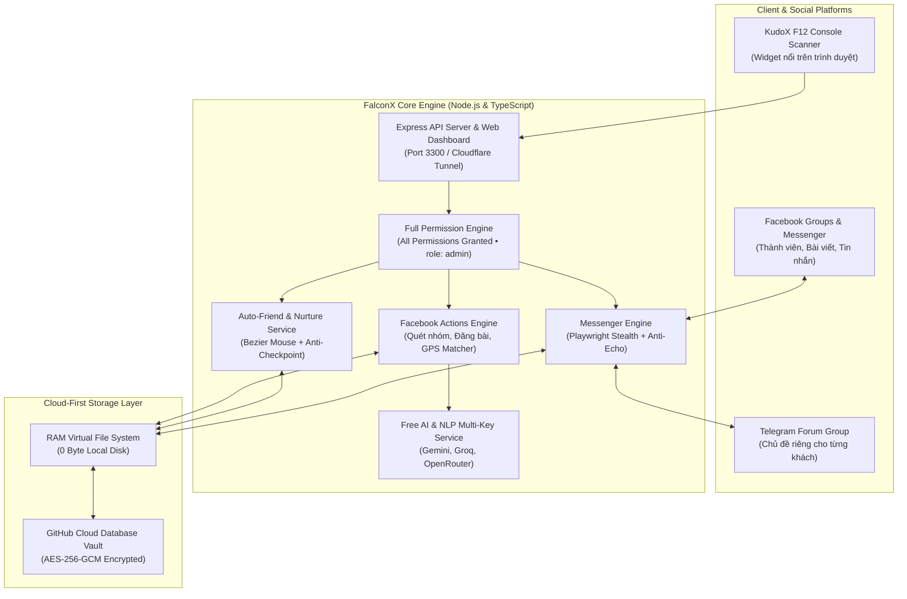

# FB EXTEN — HYBRID AUTOMATION & PRIVATE CHROME EXTENSION 🚀

> **Cài đặt Chrome Extension Private (`fb-exten/`):** Chạy `npm run build:ext` → mở `chrome://extensions` → bật **Developer mode** → **Load unpacked** chọn thư mục `fb-exten/`. Dùng chung lõi thuật toán tại `src/shared/fb-exten-core.ts`.

> **Hệ thống điều phối đa kênh Facebook Messenger $\leftrightarrow$ Telegram Forum Topics kết hợp Tự Động Hóa Nuôi Khách, Quét Thành Viên Group & Đăng Bài Thông Minh (100% Cloud Database Vault — 0 Byte Lưu Local).**

---

## 🌟 TỔNG QUAN HỆ THỐNG & TÍNH NĂNG CHÍNH

1. **Đồng Bộ Hai Chiều Messenger $\leftrightarrow$ Telegram Forum Topics**:
   - Tự động tạo một Forum Topic riêng cho mỗi khách hàng Facebook.
   - Hỗ trợ đầy đủ văn bản, biểu tượng cảm xúc, hình ảnh, video, ghi âm và chỉ báo đang soạn tin (`typing`).
   - Kháng trùng lặp phản hồi (Anti-Echo Guard) chuẩn xác.

2. **Cơ Sở Dữ Liệu Đám Mây 100% (Zero-.env Cloud Database Vault)**:
   - Dữ liệu được mã hóa `AES-256-GCM + GZIP` và đồng bộ tự động lên nhánh `cloud-database` trên GitHub.
   - **0 Byte lưu trữ trên ổ cứng cục bộ**: Toàn bộ dữ liệu nằm trong RAM Virtual File System và GitHub Vault.

3. **Cơ Chế Phân Quyền Toàn Năng (All Permissions Granted)**:
   - Cấp mọi quyền quản trị (`role: 'admin'`, `permissions: ['*']`, `fullAccess: true`) cho toàn bộ phiên làm việc, API và tài khoản.
   - Không bị chặn bởi 401 khi truy cập qua Web Tunnel, F12 script hoặc API bên ngoài.
   - GitHub Actions CI/CD được cấp quyền `permissions: write-all`.

4. **Động Cơ KudoX 2 — Nuôi Tương Tác & Tự Động Kết Bạn Sinh Học**:
   - Trỏ chuẩn xác nhãn F12 `[role="button"][aria-label="Thêm bạn bè"]` / `span:text-is("Thêm bạn bè")`.
   - Tuyệt đối loại trừ nút `Tìm bạn bè` trên Header, `Hủy lời mời`, `Nhắn tin`.
   - Mô phỏng hành vi người thật: Cuộn mượt, rê chuột theo đường cong Bezier, dừng đọc 1.5s - 3s, Hover dwell 400ms - 800ms.
   - Cơ chế nghỉ sinh học `20s - 38s` và nghỉ giải lao sâu (Coffee Break) sau mỗi 4 lượt.
   - Lá chắn tự động đóng Popup cảnh báo Checkpoint (`"Bạn có biết người này ngoài đời không?"`).

5. **Phân Mảng Độc Lập BĐS Ecopark & Forex Tài Chính**:
   - Hỗ trợ chạy song song 2 mảng độc lập cho các thành viên trong đội ngũ.
   - Bóc tách bình luận, tính khoảng cách tọa độ GPS thực (`Haversine`) giữa nhu cầu khách và quỹ căn.
   - Bình luận mồi tự động theo mẫu chuẩn Ecopark: `LH/Zalo: 0981992137 hoặc ib e có ngay ạ`.

---

## 🏗️ SƠ ĐỒ KIẾN TRÚC HỆ THỐNG (ARCHITECTURE)



---

## 📁 CẤU TRÚC THƯ MỤC CHUẨN WORKFLOW

```text
.
├── .github/
│   └── workflows/
│       ├── ci.yml                 # CI/CD: Type-check, Build & Security Audit (write-all)
│       └── cloud-sync.yml         # Tự động đồng bộ và kiểm tra Cloud Database
├── docs/
│   ├── ARCHITECTURE.md            # Tài liệu chi tiết kiến trúc hệ thống
│   └── WORKFLOW.md                # Quy trình vận hành chuyên nghiệp cho team
├── public/
│   ├── index.html                 # Giao diện Web Dashboard điều khiển trung tâm
│   └── scripts/
│       └── kudox-f12-member-scanner.js # Script F12 quét & tự động kết bạn trên Facebook
├── src/
│   ├── config/                    # Cấu hình môi trường & bộ mẫu câu trả lời
│   ├── core/                      # Trình duyệt Stealth, Human Behavior & Checkpoint Guard
│   ├── db/                        # Online Cloud DB, User Store, Auto Comment Store
│   ├── engine/                    # Messenger Engine, Actions Engine, Orchestration
│   ├── scripts/                   # CLI Tools: login, test-telegram, status, sync-cloud
│   ├── services/                  # Business Logic: Auto-Friend, AI, GPS, Inventory
│   ├── telegram/                  # Telegram Bot & Topic Router
│   ├── ui/                        # Web Dashboard API & Controllers
│   └── index.ts                   # Điểm khởi động chính của ứng dụng
├── .editorconfig                  # Quy chuẩn định dạng code đồng nhất
├── .gitignore                     # Bỏ qua dependencies, cookies live, build cache
├── package.json                   # Scripts chuẩn: start, dev, build, type-check, status
├── start.bat                      # Khởi chạy 1 chạm trên Windows
├── start.ps1                      # Khởi chạy PowerShell (Bypass Execution Policy)
├── start.sh                       # Khởi chạy trên Linux / macOS
└── tsconfig.json                  # Cấu hình TypeScript Strict Mode
```

---

## ⚡ HƯỚNG DẪN KHỞI CHẠY NHANH

### 1. Yêu Cầu Môi Trường
- **Node.js**: Phiên bản 20 trở lên (khuyên dùng Node.js 22 LTS).
- **Trình duyệt**: Google Chrome hoặc Chromium.

### 2. Khởi Chạy Nhanh 1 Chạm
- **Windows (CMD/Explorer)**: Nhấp đúp vào `start.bat`.
- **Windows (PowerShell)**: Chạy `.\start.ps1`.
- **Linux / macOS**: Chạy `./start.sh`.

### 3. Lệnh Thao Tác (NPM Scripts)

```bash
# 1. Khởi chạy hệ thống chính thức
npm start

# 2. Khởi chạy chế độ phát triển (Auto-reload)
npm run dev

# 3. Kiểm tra tính toàn vẹn kiểu dữ liệu TypeScript (Zero errors)
npm run type-check

# 4. Biên dịch mã nguồn ra thư mục dist
npm run build

# 5. Kiểm tra kết nối Telegram Bot
npm run test-tele

# 6. Xem báo cáo tổng quan sức khỏe hệ thống
npm run status

# 7. Đăng nhập nick Facebook mới qua giao diện Chrome
npm run login

# 8. Đồng bộ thủ công dữ liệu lên GitHub Cloud Database
npm run cloud:sync
```

---

## 🛡️ CHÍNH SÁCH BẢO MẬT & PHÂN QUYỀN (PERMISSIONS)

- **Cấp mọi quyền (Full Privileges)**: Toàn bộ người dùng đăng nhập hoặc qua link mời đều có quyền Admin tối cao, có thể quản trị dàn nick, chỉnh sửa cấu hình AI, điều phối bài đăng và đồng bộ Cloud.
- **An toàn thông tin**: Cookie và phiên làm việc Facebook được bảo vệ và mã hóa, không bao giờ đẩy lộ công khai lên Git.
- **Không Checkpoint**: Mọi hành động tương tác (kết bạn, thả tim, bình luận) đều áp dụng nhịp sinh học ngẫu nhiên và tự động đóng hộp thoại cảnh báo của Facebook.

---

## 👥 BẢN QUYỀN & GIẤY PHÉP

Phát triển bởi đội ngũ KudoX & FalconX. Bảo lưu mọi quyền.
Mã nguồn phục vụ công tác điều phối tự động hóa tin nhắn và vận hành bất động sản, tài chính.
