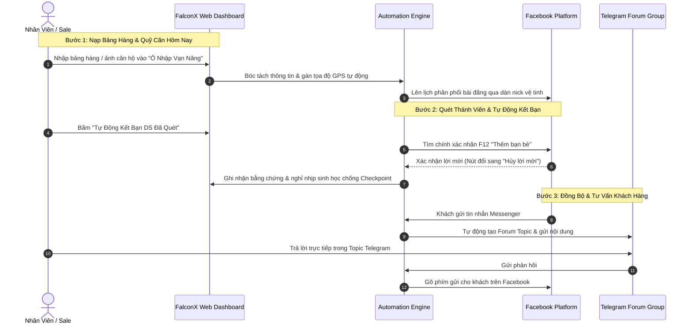

# QUY TRÌNH VẬN HÀNH CHUYÊN NGHIỆP (TEAM WORKFLOW)

## 1. Quy Trình Vận Hành Hàng Ngày Của Nhân Viên

---

## 2. Hướng Dẫn Sử Dụng Chi Tiết

### A. Vận Hành Tự Động Kết Bạn Trên Danh Sách Đã Quét
1. **Qua Giao Diện Web Dashboard**:
   - Truy cập `http://localhost:3300` (hoặc link Cloudflare Tunnel công khai).
   - Chọn tab **Tăng Trưởng & Auto-Comment**.
   - Tại bảng **Topic 3 — Quét Sâu Thành Viên Mới Group**, chọn mốc thời gian lọc (ví dụ: `🔥 2 Ngày Gần Nhất`).
   - Bấm nút **`🤝 Tự Động Kết Bạn DS Đã Quét (Nhãn F12: "Thêm bạn bè")`**.
   - Hệ thống tự động phân bổ danh sách thành viên cho dàn nick, rê chuột Bezier và click đúng nhãn `"Thêm bạn bè"`.

2. **Qua Widget F12 Ngay Trên Trình Duyệt**:
   - Mở Group Facebook bất kỳ tại mục `/members`.
   - Bấm phím **F12**, chuyển sang tab **Console**, dán toàn bộ nội dung từ file `public/scripts/kudox-f12-member-scanner.js` và nhấn **Enter**.
   - Hộp điều khiển nổi KudoX sẽ xuất hiện ở góc phải màn hình.
   - Bấm **`🤝 CHẠY TỰ ĐỘNG KẾT BẠN (TRỎ "Thêm bạn bè")`** để chạy trực tiếp trên tab Facebook hiện tại.

### B. Vận Hành Báo Cáo Tổng Kết Telegram (20:30 Hàng Ngày)
- Hệ thống tự động tổng hợp hiệu suất 6 tác vụ (Đăng bài, Bình luận mồi, Quét thành viên, Kết bạn, Thả tim story, Thích bài viết) và gửi vào nhóm Telegram lúc 20:30 mỗi tối.
- Có thể gửi thủ công bất kỳ lúc nào bằng nút **`Gửi Báo Cáo Tổng Kết Về Telegram Ngay`** trên Web Dashboard.
